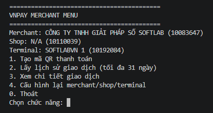
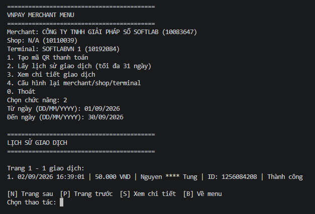

# VNPay Merchant CLI

Ứng dụng CLI Node.js tích hợp với **VNPay Merchant View** để hỗ trợ merchant tạo mã QR thanh toán và tra cứu giao dịch trực tiếp từ terminal.

## Tính năng

- Đăng nhập VNPay qua Keycloak SSO/OIDC.
- Hỗ trợ đăng nhập lần đầu bằng số điện thoại, mật khẩu và OTP.
- Lưu cookie session và `deviceId` để sử dụng lại phiên đăng nhập.
- Lấy danh sách merchant mà tài khoản được cấp quyền.
- Chọn merchant, shop và terminal thay vì mặc định lấy phần tử đầu tiên.
- Lưu cấu hình merchant/shop/terminal đã chọn vào session.
- Tự động dùng lại cấu hình hợp lệ ở những lần chạy sau.
- Cấu hình lại merchant/shop/terminal ngay trong menu.
- Tạo mã QR thanh toán với số tiền tùy chọn.
- Hiển thị chuỗi QR gốc và QR dạng ASCII trong terminal.
- Tra cứu lịch sử giao dịch trong khoảng thời gian tối đa 31 ngày.
- Phân trang lịch sử giao dịch với `N` (trang sau), `P` (trang trước), `S` (xem chi tiết) và `B` (về menu).
- Xem chi tiết giao dịch từ danh sách hoặc nhập thủ công `transactionMappingId`.
- Hiển thị merchant/shop/terminal hiện tại trên menu chính.

## Yêu cầu

- Node.js 18 trở lên.
- Tài khoản VNPay Merchant View hợp lệ.
- Quyền truy cập merchant/shop/terminal tương ứng.
- Có thể nhận OTP trong lần đăng nhập đầu tiên hoặc khi session hết hạn.

## Cài đặt

```bash
git clone https://github.com/petertuananh/VNPay-Merchant-CLI.git
cd VNPay-Merchant-CLI
npm install
```

Tạo file `.env` từ `.env.example`:

```env
VNPAY_USERNAME=your_phone_number
VNPAY_PASSWORD=your_password
DEFAULT_QR_AMOUNT=10000
MAX_STEP_LIMIT=10
```

Không commit `.env`. File này chứa thông tin đăng nhập và đã được thêm vào `.gitignore`.

## Chạy ứng dụng

```bash
node .
```

Hoặc:

```bash
node src/index.js
```

## Luồng đăng nhập

### Lần chạy đầu tiên

Ứng dụng thực hiện các bước:

1. Khởi tạo PKCE và mở luồng Keycloak SSO.
2. Gửi số điện thoại.
3. Chọn phương thức đăng nhập bằng mật khẩu.
4. Gửi mật khẩu.
5. Yêu cầu nhập OTP nếu VNPay yêu cầu.
6. Đổi authorization code lấy access token.
7. Yêu cầu token nội bộ VNPay Merchant View.


Khi được yêu cầu, VNPay sẽ gửi mã OTP để xác minh truy cập. Mã OTP chỉ có hiệu lực trong thời gian ngắn và không được chia sẻ cho người khác.


### Các lần chạy sau

Cookie và `deviceId` được đọc từ `vnpay_session.json`. Nếu session còn hiệu lực, ứng dụng có thể bỏ qua giao diện đăng nhập.


> `vnpay_session.json` có thể chứa cookie xác thực. Không chia sẻ hoặc commit file này.

## Chọn merchant, shop và terminal

Sau khi xác thực, ứng dụng lấy danh sách merchant và hiển thị để người dùng chọn:


Các bước:

1. Chọn `merchantId`.
2. Chọn `shopId` thuộc merchant đã chọn.
3. Chọn `terminalId` thuộc shop đã chọn.

Cấu hình được lưu trong `vnpay_session.json` dưới khóa `selectedContext`:

```json
{
  "selectedContext": {
    "merchantId": 10083647,
    "shopId": 10110039,
    "terminalId": 10192084,
    "merchantName": "Tên merchant",
    "shopName": "Tên shop",
    "terminalName": "Tên terminal"
  }
}
```

Nếu merchant, shop hoặc terminal đã lưu không còn hợp lệ, ứng dụng sẽ yêu cầu chọn lại.

## Menu chính

```text
VNPAY MERCHANT MENU
Merchant: Tên merchant (merchantId)
Shop: Tên shop (shopId)
Terminal: Tên terminal (terminalId)
1. Tạo mã QR thanh toán
2. Lấy lịch sử giao dịch (tối đa 31 ngày)
3. Xem chi tiết giao dịch
4. Cấu hình lại merchant/shop/terminal
0. Thoát
```



## Tạo mã QR thanh toán

Chọn `1`, sau đó nhập số tiền bằng VND. Nếu bỏ trống, ứng dụng dùng `DEFAULT_QR_AMOUNT`.

Ứng dụng gọi endpoint:

```text
POST /mcview-backoffice/payment-utility/add
```

Sau khi tạo thành công, terminal hiển thị chuỗi QR gốc và QR dạng ASCII để quét trực tiếp từ màn hình.


QR có thể được quét bằng ứng dụng ngân hàng để thực hiện thanh toán.


## Lịch sử giao dịch

Chọn `2`, nhập ngày theo định dạng `DD/MM/YYYY`:

```text
Từ ngày (DD/MM/YYYY): 01/09/2026
Đến ngày (DD/MM/YYYY): 30/09/2026
```

Khoảng thời gian tối đa là 31 ngày. Ứng dụng gọi:

```text
POST /mcview-backoffice/transaction/search?page=0&size=30
```

Mỗi trang hiển thị tối đa 30 giao dịch. Menu thao tác:

```text
[N] Trang sau
[P] Trang trước
[S] Xem chi tiết
[B] Về menu
```



Khi chọn `S`, nhập số thứ tự giao dịch trong trang hiện tại. Ứng dụng tự lấy `paymentSource`, `transactionMappingId` và `transactionMappingDate` từ kết quả danh sách để gọi API chi tiết.

## Chi tiết giao dịch

Ứng dụng gọi:

```text
POST /mcview-backoffice/transaction/detailV2
```

Thông tin hiển thị gồm ID giao dịch, thời gian tạo, số tiền, khách hàng, số điện thoại đã che một phần, mã hóa đơn, ngân hàng, trạng thái, mã giao dịch đối soát, mã tham chiếu và ghi chú giao dịch.


Ngoài cách chọn từ lịch sử, mục `3` trong menu chính cho phép nhập thủ công:

```text
transactionMappingId
transactionMappingDate (DD/MM/YYYY HH:mm:ss)
```

## Cấu hình lại merchant/shop/terminal

Chọn `4` trong menu chính để tải lại danh sách và chọn cấu hình khác. Cấu hình mới được lưu vào `vnpay_session.json`, áp dụng ngay cho các chức năng tiếp theo và hiển thị lại trên menu chính.

## Cấu trúc thư mục

```text
.
├── images/
│   ├── Choose merchant - shop - term.png
│   ├── Configs & credentials save.png
│   ├── Create QR.png
│   ├── First login.png
│   ├── Menu.png
│   ├── Receive OTP.jpg
│   ├── Test transfer by created QR.jpg
│   ├── Transaction detailed.png
│   └── Transactions.png
├── src/
│   └── index.js
├── .env.example
├── package.json
└── README.md
```

## Bảo mật

- Không commit `.env`, `vnpay_session.json` hoặc các file session bản sao.
- Không chia sẻ password, OTP, access token, authorization header hoặc cookie.
- Session file chứa thông tin xác thực có thể truy cập tài khoản merchant.
- Nếu session bị lộ, hãy đăng xuất/thu hồi phiên theo chính sách VNPay và xóa file session cục bộ.
- Chỉ sử dụng ứng dụng với tài khoản và merchant mà bạn được ủy quyền.

## Giới hạn hiện tại

- Ứng dụng phụ thuộc vào API nội bộ của VNPay Merchant View; endpoint hoặc schema có thể thay đổi theo phía VNPay.
- OTP vẫn cần người dùng nhập thủ công khi được yêu cầu.
- Lịch sử giao dịch được giới hạn tối đa 31 ngày theo luồng hiện tại.
- Đây là công cụ CLI cộng đồng, không phải ứng dụng chính thức của VNPay.

## Kiểm tra mã nguồn

```bash
node --check src/index.js
```

## License

Dự án sử dụng license ISC theo `package.json`.
